# 実験ノート：複雑な記憶は個性形成に必要か — アブレーション条件ごとの個体性（Phase 16・17）

| 項目 | 内容 |
|---|---|
| 日付 | 2026-11-14（土） |
| 実施者 | Claude Code（依頼：st19060nk） |
| 種別 | オフライン数値実験（Minecraft は起動しない） |
| 対象コード | `demo-mode` ブランチ。このノートと同じコミット（アブレーション条件の追加。既存 3 条件の挙動はビット単位で不変をテストで確認） |
| パラメータ | `PARAMETER_SET_VERSION = 2`（**変更なし**）、τ = 0.60 |
| シード | 30 個（20261114〜20261143）。同じシードなら、どの条件でも出来事列と個体の乱数列が同一 |
| 再現コマンド | `./gradlew individuality`（約 25 秒）→ `python analysis/ablation.py research-output/individuality/separation_by_seed.csv` |
| 生の出力 | [`2026-11-14_ablation-individuality/`](2026-11-14_ablation-individuality/)：`individuality_report.md`（全条件・全パターンの表）、`separation_by_seed.csv`（シードごとの個体内・個体間距離と分離比）、`ablation_paired.md` / `.csv`（対応のある比較）。行動指紋の全行 `signatures.csv` と距離の全組 `distances.csv`（計約 2 MB）は再現コマンドで作り直せるので置いていない |
| 関連ノート | [`2026-11-14_state-saturation.md`](2026-11-14_state-saturation.md)（同じ育成パターンを使用） |

---

## 1. 目的

研究質問「**複雑な記憶は、本当に AI ペットの個性形成に必要なのか？**」に答えるための基盤を作り、最初の測定を行う。

これまでの条件は STATIC / STATE_ONLY / ADAPTIVE の 3 つで、ADAPTIVE では状態・エピソード記憶・空間記憶・選好学習が同時に ON になる。
そのため ADAPTIVE が優れていても、記憶が必要だったのか選好学習が必要だったのかを分けられなかった。
今回、機構を 1 つずつ ON / OFF できるようにして、個体性への寄与を比べる。

## 2. 仮説

* **H1**：学習を行わない STATIC では、経験の違う個体どうしの行動指紋の差（個体間距離）は、同じ個体の測定ごとのばらつき（個体内距離）と同程度になる（分離比 ≈ 1）。
* **H2**：内部状態だけ（STATE_ONLY）でも、経験の違いから個体差が生じる（分離比 > 1）。
* **H3**：記憶・選好学習を加えると個体差はさらに大きくなる。それぞれの寄与の大きさは未知。
* **H4**：天井効果のノートの結果から、長い育成（120 分）では内部状態が張り付くため、状態以外の機構の寄与が相対的に大きくなる。

## 3. 実験手順

### 3.1 条件（機能フラグ `AdaptiveFeatures`）

| 条件 | 状態の学習 | エピソード記憶 | 空間記憶 | 選好学習 |
|---|:---:|:---:|:---:|:---:|
| STATIC（対照） | − | − | − | − |
| STATE_ONLY | ○ | − | − | − |
| STATE_SPATIAL | ○ | − | ○ | − |
| STATE_EPISODIC | ○ | ○ | − | − |
| STATE_MEMORY | ○ | ○ | ○ | − |
| STATE_PREFERENCE | ○ | − | − | ○ |
| ADAPTIVE（= FULL_ADAPTIVE） | ○ | ○ | ○ | ○ |

* 条件の違いは上の 4 つのフラグだけ。行動集合・重み・基礎値・文脈の処理・Softmax 温度・継続ボーナスは全条件で同一（テストで確認）。
* STATIC でも一時的な感情（fear・stress）は出来事に反応する（既存の STATIC の定義）。
* 既存の 3 条件は、これまで 1 つだったエピソード記憶と空間記憶のフラグを 2 つに分けたが、常に同じ値なので挙動は変わらない
  （スコア・選択・実験前シミュレーションの結果がビット単位で一致することをテストで確認）。

### 3.2 育成

天井効果のノートと同じ 4 パターン（A 飼い主中心・B 探索中心・C 危険が多い・D 混合）、強さ typical、
育成時間 30 分（1 セッション相当）と 120 分。出来事の頻度は同ノートの表 3.1 のとおり（仮定）。
1 シードにつき 4 パターン × 7 条件の個体を作る。**同じシード・同じパターンなら、条件が違っても出来事列と個体の乱数列は同一**で、
違いは学習・記憶機構の ON / OFF だけ。

### 3.3 評価までの間隔（重要）

最初に育成直後に評価したところ、**学習を行わない STATIC でも分離比が 5.4 になった**。
原因は、育成の最後の数分の出来事で一時的に高まった fear・stress（C の個体で約 0.97）と、パターンで異なる energy が、
そのまま指紋に入るためである。これは「経験から形成された個性」ではなく「測定時の一時的な気分」である。

そこで評価のタイミングを 2 通りにした。

* **0 分**：育成直後に評価
* **60 分**：出来事のない 60 分を挟んでから評価（次のセッションの想定）。この間は拠点の平穏な文脈（飼い主 6 blocks、敵なし、昼）で
  2 秒ごとに決定し、時間は育成と同じ `advanceTime` で進める（感情の回帰・energy の増減・記憶の時間減衰は実機と同じ規則）

**結論には 60 分の結果を使う。**

### 3.4 行動指紋と距離

標準テストバッテリ（`StandardTestBattery`、200 決定。既存のものをそのまま使用、個体は変更しない）を 1 セッションとし、
1 個体につき 3 セッション測る。1 セッションの行動指紋は 12 次元：

| 次元 | 内容 |
|---|---|
| 8 行動の出現割合 | 拠点の領域で測定 |
| dangerRetreatRate / dangerDefendRate | 脅威区間（200 決定中 50 決定、敵 2 体が 7 blocks）での RETREAT / DEFEND_PLAYER の割合 |
| probeAvoidRate | パターン C が被弾した最初の場所で測った AVOID_LOCATION の割合 |
| meanOwnerDistance / 40 | 標準テストの飼い主距離（上限 40 blocks）を 0〜1 に正規化 |

研究計画にあった explorationRadius と dangerRegionRevisitRate は、標準テストが空間を移動しないため測れない（作っていない）。

* 個体内距離：同じ個体の 3 セッションの総当たり 3 組の平均
* 個体間距離：同じシード・同じ条件の、異なるパターンの個体どうし 6 組の平均（各セッション 1）
* 分離比 = 個体間距離 ÷ 個体内距離。**シードごとに計算し、30 シードの平均 ± 標準偏差**を報告する
* 距離は Euclidean（主指標、12 次元）、Cosine（同じベクトル）、Jensen–Shannon（8 行動の割合、底 2）
* 条件間の比較は、シードを対応とした**対応のある t 検定**（両側、n = 30、多重比較の補正なし）

## 4. 結果

### 4.1 分離比（Euclidean、評価まで 60 分、30 シード）

| 条件 | 育成 30 分：分離比 | STATE_ONLY との差 [95% CI] | p | 育成 120 分：分離比 | STATE_ONLY との差 [95% CI] | p |
|---|---:|---:|---:|---:|---:|---:|
| STATIC | **1.26 ± 0.26** | −5.06 [−5.46, −4.66] | 1.3e-21 | **1.23 ± 0.23** | −6.27 [−6.69, −5.86] | 1.3e-23 |
| STATE_ONLY | 6.31 ± 1.04 | — | — | 7.51 ± 1.13 | — | — |
| STATE_SPATIAL | 6.38 ± 1.05 | +0.06 [−0.00, +0.13] | 0.059 | 7.43 ± 1.05 | −0.08 [−0.24, +0.08] | 0.31 |
| STATE_EPISODIC | 7.15 ± 0.91 | +0.83 [+0.50, +1.17] | 1.9e-05 | 8.18 ± 1.14 | +0.67 [+0.21, +1.14] | 0.006 |
| STATE_MEMORY | 7.19 ± 0.90 | **+0.88** [+0.54, +1.22] | 1.1e-05 | 8.15 ± 1.24 | **+0.64** [+0.19, +1.08] | 0.0066 |
| STATE_PREFERENCE | 6.91 ± 0.87 | **+0.60** [+0.32, +0.88] | 0.00017 | 8.79 ± 1.11 | **+1.28** [+0.88, +1.67] | 3.0e-07 |
| ADAPTIVE (FULL) | **8.17 ± 1.00** | **+1.85** [+1.41, +2.30] | 1.8e-09 | **9.51 ± 1.33** | **+2.00** [+1.44, +2.55] | 4.6e-08 |

ADAPTIVE が STATE_ONLY を上回ったシードは、30 分で 29/30、120 分で 27/30。

Jensen–Shannon（8 行動の割合のみ）でも順序は同じ（30 分・60 分間隔）：STATIC 1.76、STATE_ONLY 22.36、
STATE_PREFERENCE 27.38（+5.02、p = 1.2e-10）、STATE_MEMORY 29.45（+7.09、p = 4.3e-09）、ADAPTIVE 35.80（+13.45、p = 4.5e-11）。

```mermaid
xychart-beta
    title "分離比（個体間距離 / 個体内距離、Euclidean、評価まで 60 分、30 シード平均）"
    x-axis "条件" [STATIC, STATE_ONLY, STATE_SPATIAL, STATE_EPISODIC, STATE_MEMORY, STATE_PREF, FULL]
    y-axis "分離比（1 = 個体差なし）" 0 --> 10
    bar [1.26, 6.31, 6.38, 7.15, 7.19, 6.91, 8.17]
    bar [1.23, 7.51, 7.43, 8.18, 8.15, 8.79, 9.51]
```

図 1：各条件の左の棒が育成 30 分、右の棒が育成 120 分。

### 4.2 育成直後に評価した場合（参考、交絡あり）

| 条件 | 育成 30 分 | 育成 120 分 |
|---|---:|---:|
| STATIC | 5.44 ± 0.80 | 5.06 ± 0.69 |
| STATE_ONLY | 9.44 ± 1.73 | 9.11 ± 1.30 |
| STATE_MEMORY | 11.45 ± 2.20 | 10.80 ± 1.96 |
| STATE_PREFERENCE | 10.87 ± 2.32 | 10.45 ± 1.85 |
| ADAPTIVE | 12.80 ± 2.47 | 12.56 ± 2.14 |

条件の順序は 60 分間隔と同じだが、STATIC の 5.4 が示すように、すべての値に一時的な感情の差が上乗せされている。

### 4.3 パターンごとの行動指紋（育成 30 分・評価まで 60 分、セッション 1、30 シード平均、割合 [%]）

| 条件 | パターン | APPROACH | FOLLOW_CLOSE | EXPLORE | 危険時 RETREAT | 危険時 DEFEND | 危険地帯 AVOID | 平均距離 [blocks] |
|---|---|---:|---:|---:|---:|---:|---:|---:|
| STATIC | A / B / C / D | 16.5 / 16.6 / 18.0 / 17.0 | 5.3 / 4.8 / 7.6 / 6.2 | 29.1 / 27.1 / 26.5 / 30.4 | 2.6 / 2.5 / 4.5 / 3.4 | 19.1 / 21.1 / 21.0 / 19.4 | 0 / 0 / 0 / 0 | 7.3 / 6.9 / 6.6 / 7.2 |
| STATE_ONLY | A | 36.5 | 7.4 | 12.4 | 0.3 | 46.7 | 0.0 | 3.6 |
| STATE_ONLY | B | 2.1 | 0.5 | 84.0 | 0.7 | 3.0 | 0.0 | 33.7 |
| STATE_ONLY | C | 24.9 | 7.7 | 13.6 | 2.2 | 34.9 | **0.0** | 4.5 |
| STATE_MEMORY | A | 53.8 | 14.5 | 8.3 | 0.1 | 29.4 | 0.0 | 2.2 |
| STATE_MEMORY | C | 34.6 | 17.0 | 6.1 | 4.8 | 20.1 | **12.2** | 2.9 |
| STATE_PREFERENCE | A | 43.0 | 8.7 | 11.0 | 0.2 | 42.9 | 0.0 | 3.1 |
| ADAPTIVE | A | 59.5 | 15.3 | 6.2 | 0.0 | 25.2 | 0.0 | 1.9 |
| ADAPTIVE | B | 1.5 | 0.3 | 89.3 | 0.6 | 2.1 | 0.0 | 35.8 |
| ADAPTIVE | C | 33.3 | 17.4 | 3.6 | 7.9 | 19.4 | **11.2** | 2.8 |

（全条件・全パターン・全列は生の出力 `individuality_report.md`）

## 5. 考察

### Q3：内部状態だけの場合と、記憶・選好を加えた場合で、経験から形成される個体性はどの程度違うか

1. **H1 は支持された。** 60 分の間隔を置くと、STATIC の分離比は 1.26 / 1.23 で、個体差はほぼない。
   これにより、測定系が「経験と無関係な差」を個体性として拾っていないことが確かめられた（対照として機能している）。
2. **H2 は支持された。個体性の大部分は内部状態だけで生じる。** STATE_ONLY の分離比は 6.31（30 分）で、
   FULL（8.17）との差 1.85 に対して、STATIC からの増加は 5.06 ある。分離比で見ると、STATIC → FULL の増加の約 73 %
   （5.06 / 6.91）は内部状態だけで説明される。
3. **H3 は支持された。記憶と選好は、それぞれ有意だが小さい上乗せをする。**
   * 記憶（STATE_MEMORY）：+0.88（30 分）、+0.64（120 分）
   * 選好（STATE_PREFERENCE）：+0.60（30 分）、+1.28（120 分）
   * 両方（FULL）：+1.85 / +2.00。2 つの寄与はほぼ足し算（0.88 + 0.60 = 1.48 に対して 1.85。30 分ではやや相乗的）
4. **H4 は部分的に支持された。** 120 分では選好の寄与が 30 分の 2 倍以上（+0.60 → +1.28）になり、記憶の寄与は減った（+0.88 → +0.64）。
   選好は学習率が小さく時間で減らないので長期でゆっくり効き、エピソード記憶は Top-5 と時間減衰（30 分）で頭打ちになるため、と解釈できる。
   ただし STATE_ONLY の分離比自体も 6.31 → 7.51 に増えており、天井効果で状態の個体差が「消えた」わけではない。
   A は trust・attachment、B は curiosity・autonomy と**別の状態が張り付く**ので、パターン間の差は残る。
5. **空間記憶は、行動全体の個体性にはほとんど寄与しない**（STATE_SPATIAL − STATE_ONLY = +0.06、p = 0.059 / −0.08、p = 0.31）。
   空間記憶の効果は**場所に特有**で、危険地帯での AVOID_LOCATION（C の個体で 0 % → 11〜12 %）にだけ現れる。
   12 次元の指紋のうち 1 次元しか動かないため、全体の距離にはほとんど効かない。
   「その場所を覚えている」ことの評価には、全体の指紋ではなく場所ごとの指標を使う必要がある。
6. **記憶がないと、危険の経験が「場所の記憶」として残らない。** STATE_ONLY の C（危険が多い）の個体は、60 分後には fear が戻り、
   救援・防衛で上がった trust によって A に近い指紋になる（APPROACH 24.9 %、危険地帯 AVOID 0 %）。
   記憶がある条件では、危険地帯でだけ避ける（11〜12 %）ことで C らしさが残る。

### 研究質問への暫定的な答え

**「複雑な記憶がなくても、内部状態だけでかなりの個体性は生じる。ただし記憶と選好学習はそれぞれ有意に個体性を強め、
とくに記憶は『どこで何があったか』という、内部状態では表せない種類の個体差を作る。」**
個体性の量（分離比）だけで記憶の必要性を論じると、記憶の価値を過小評価する。Study 2（記憶を覚えていると人は感じるか）では、
場所・出来事に特有の行動を評価指標に含めるべきである。

## 6. 限界

* 出来事の頻度は仮定（天井効果のノートと同じ）。とくに混合と危険のパターンの現実性は未確認。
* 評価は標準テストバッテリ（固定の文脈スケジュール、空間移動なし）。実機の自由行動での個体性とは異なる。
* 分離比は個体内距離（200 決定のサンプリングのばらつき、約 0.1）で割っているので、決定数を増やすと値は大きくなる。
  **条件間の比較にだけ使い、絶対値に意味を持たせない**こと。
* 12 次元の指紋は行動割合 8 次元が支配的で、場所・危険への反応の次元の重みは小さい（重み付けは未検討）。
* 対応のある t 検定を 6 条件 × 2 時間で行っており、多重比較の補正をしていない（ただし主要な差の p 値は 1e-4 以下）。
* 4 パターンの間の差であり、同じパターン内の「経験の量」の差による個体性は測っていない（天井効果の影響を最も受けるのはこちら）。

## 7. 次に行うべきこと

1. **同じパターン内の経験量の差**（例：A 型で撫で 1 回/分と 3 回/分）でも分離が出るかを、条件ごとに測る。
   天井効果が個体性を損なうかどうかは、こちらでより直接に分かる。
2. 場所・出来事に特有の指標（危険地帯での回避、救援者への接近など）を指紋に加えるか、別の指標として報告する。
3. 実機パイロットのログ（`decisions.jsonl` の成分内訳、`decisionLogSchemaVersion 2`）で、
   STATE_ONLY / STATE_MEMORY / FULL の 3 条件を実際のプレイで比べる。
4. P2：Python の解析パイプライン（`analysis/`）と図 1〜4 の作成、研究ログのスキーマ整理。
