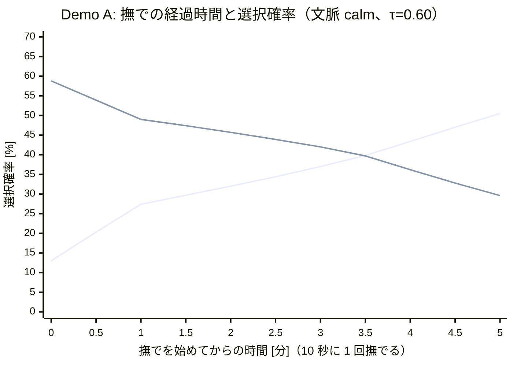
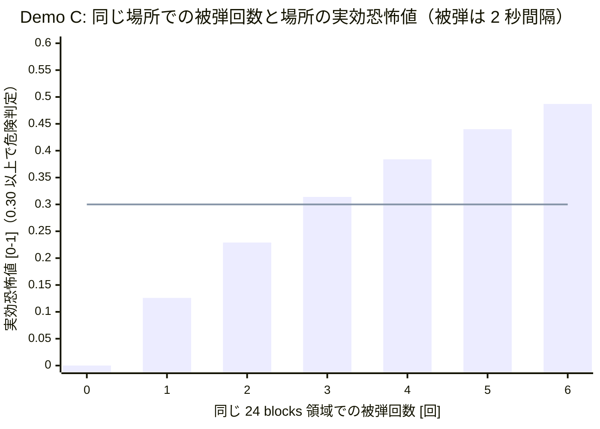

# 実験ノート：デモ撮影で与える経験は、研究パラメータのままどれだけ行動確率を変えるか

| 項目 | 内容 |
|---|---|
| 日付 | 2026-11-14（土） |
| 実施者 | Claude Code（依頼：st19060nk） |
| 種別 | オフライン数値実験（Minecraft は起動しない） |
| 対象コード | `demo-mode` ブランチ。研究ロジックはコミット `6bf7af9` 時点、測定ツールはこのノートと同じコミットで追加 |
| パラメータ | `PARAMETER_SET_VERSION = 2`（変更なし）、Softmax 温度 τ = 0.60、実験シード 42、条件 ADAPTIVE |
| 再現コマンド | `./gradlew demoEstimate`（ソース：`src/main/java/jp/ac/naist/hai/aiwolf/demo/DemoEffectSizeEstimate.java`） |
| 生の出力 | [`2026-11-14_demo-effect-size.output.md`](2026-11-14_demo-effect-size.output.md)（本ノートの数値はすべてここから転記） |
| 関連文書 | [`docs/DEMO_RECORDING.md`](../DEMO_RECORDING.md)（撮影手順。本ノートの結果を反映済み） |

---

## 1. 目的

教授向けのデモ動画（1〜2 分）で「同じ初期状態の AI ペットが、経験によって行動傾向を変える」ことを見せたい。
**研究パラメータを一切変えずに**、デモで実際に与えられる程度の経験（数分間の交流、1 回の戦闘など）で、
画面上で分かる大きさの変化が出るかを事前に確かめる。

出なければ、その事実を撮影前に報告する（「動画映え」のためにパラメータを強めることはしない）。

## 2. 仮説

実験前の見積もり（2026-11-14 の初回報告）は、選好の学習率だけから計算した次のものだった。

* **H0（実験前の予想）**：撫で 1 回あたり APPROACH_PLAYER の選好は +0.004 程度しか動かないため、
  1 分程度の交流では選択確率は**数 % しか変わらず**、デモ撮影には数十分の交流が必要。

この見積もりは、内部状態（trust・attachment）とエピソード記憶の寄与を数えていなかった。
行動スコアは「基礎値 + 状態 + 文脈 + 記憶 + 選好 + 継続」の和なので、これらも同時に効くはずである。

* **H1（検証する仮説）**：状態と記憶の寄与を含めると、数分の交流・1 回の戦闘で、
  選択確率が **10 ポイント以上**変わる。
* **H2**：空間記憶による変化（AVOID_LOCATION）は**その場所でだけ**現れ、
  エピソード記憶による変化（RETREAT など）は場所を問わず現れる。

## 3. 実験手順

### 3.1 方法の概要

1. 新しい個体（`WolfAiAgent`、研究初期状態）を作る。
2. デモで想定する出来事（`WolfEvent`）を、**実機の検出器を通さずに** `onEvent` へ直接与える。
   出来事の間隔ぶん `advanceTime` で時間を進めるので、fear・stress のベースライン回帰は実機と同じ規則で起きる。
3. 決まった文脈（下表）で、全行動のスコアを `BehaviorScorer` で計算し、
   Softmax（τ = 0.60）で**選択確率**にする。
   * これは**サンプリングではなく決定論的な値**である。同じコードなら何度実行しても同じ数値になる。
   * 記憶の検索は `WolfAiAgent.decide` と同じ手順（Top-5、recency・salience・relevance）。
   * 現在行動は「なし」とする（継続ボーナス 0.25 は入れない）。
4. Demo D だけは、既存の標準テストバッテリ（`StandardTestBattery`、200 決定の**サンプリング**）を
   セッション番号 1〜5 で 5 回測り、**平均 ± 標準偏差（n = 5）**を出す。

### 3.2 文脈の定義（全個体・全時点で同一）

| 名前 | 飼い主との距離 | 飼い主 | 敵 | 時間帯 | 地下 | 場所の恐怖 |
|---|---|---|---|---|---|---|
| calm | 6 blocks | 移動中 | なし | 昼 | いいえ | 0 |
| threat | 6 blocks | 静止 | 1 体・7 blocks | 昼 | いいえ | 0 |
| cave | 6 blocks | 移動中 | なし | 昼 | はい | その個体の空間記憶の値 |

### 3.3 与えた経験

時間の単位：1 秒 = 20 ticks。撫でのクールダウン 200 ticks = 10 秒、決定間隔 40 ticks = 2 秒。

| デモ | 出来事の列 | 間隔 |
|---|---|---|
| A | 撫で ×6 → 餌 ×3 →（A2）救援 ×1 →（A3）撫で ×24 →（A4）30 分経過 | 撫で 10 秒、餌・救援 5 秒 |
| A 系列 | 撫で ×3 ずつ、0〜30 回 | 10 秒 |
| B | 敵の出現 ×1 → 被弾 ×2 → 体力低下 ×1 → 救援 ×1 →（B2）1 分 →（B3）さらに 30 分 | 2 秒 |
| C 系列 | 同じ領域で被弾 ×1 ずつ、0〜6 回 | 2 秒 |
| C | 洞窟で 敵の出現 ×1 → 被弾 ×3 → 体力低下 ×1 → 同じ場所で救援 ×1 → 2 分 →（後半）さらに 30 分 | 2 秒 |
| D | 10 分間。1 分ごとに：Wolf A は撫で ×6 + 餌 ×1、Wolf B は安全な単独探索 ×6。3 分に 1 回、A は救援、B は新バイオーム | 撫で・探索 10 秒 |

「領域」は空間記憶の単位で、24 × 24 × 24 blocks の立方体（高さ方向も区切られる）。
洞窟は座標 (200, 30, 200) の領域、別の洞窟は (400, 30, 400) の領域。

---

## 4. 結果

数値はすべて**選択確率 [%]**（Demo D のみ行動の出現割合 [%]）。小数第 1 位まで。
「pt」は％ポイント（例：13.0 % → 28.3 % は +15.3 pt）。

### 4.1 Demo A：飼い主との交流（文脈 = calm）

| 時点 | 実時間の目安 | APPROACH_PLAYER | FOLLOW_CLOSE | FOLLOW_NORMAL | EXPLORE_NEARBY | その他計 |
|---|---|---:|---:|---:|---:|---:|
| A0 初期 | 0 分 | 13.0 | 3.7 | 21.6 | 58.8 | 2.9 |
| A1 撫で 6 + 餌 3 | 1.5 分 | 28.3 | 3.2 | 18.1 | 48.5 | 1.9 |
| A2 ＋救援 1 | ＋1 戦闘 | 36.8 | 4.9 | 16.0 | 40.8 | 1.5 |
| A3 ＋撫で 24 | さらに 4 分 | 60.4 | 5.3 | 11.9 | 21.6 | 0.8 |
| A4 A3 の 30 分後 | （放置） | 59.8 | 7.4 | 14.9 | 16.2 | 1.6 |

A3 時点の内部状態：trust 0.773（初期 0.50）、attachment 0.965（初期 0.50）。
A3 時点の選好：APPROACH_PLAYER +0.125、FOLLOW_CLOSE +0.092（初期はすべて 0）。

**撫での回数と選択確率**（撫でのみ、10 秒間隔）

| 撫での回数 | 経過 [分] | P(APPROACH_PLAYER) [%] | P(EXPLORE_NEARBY) [%] | trust | attachment |
|---:|---:|---:|---:|---:|---:|
| 0 | 0.0 | 13.0 | 58.8 | 0.500 | 0.500 |
| 6 | 1.0 | 27.4 | 49.0 | 0.542 | 0.584 |
| 12 | 2.0 | 32.0 | 45.7 | 0.584 | 0.668 |
| 18 | 3.0 | 37.0 | 42.0 | 0.626 | 0.752 |
| 24 | 4.0 | 43.4 | 36.2 | 0.668 | 0.836 |
| 30 | 5.0 | 50.5 | 29.6 | 0.710 | 0.920 |

（3 回刻みの全データは生の出力を参照）

図 1：上昇する線が P(APPROACH_PLAYER)、下降する線が P(EXPLORE_NEARBY)。
2 本は約 3.5 分（撫で 21 回）で交差する。

### 4.2 Demo B：危険経験と救援（文脈 = threat）

| 時点 | RETREAT | FOLLOW_CLOSE | EXPLORE_NEARBY | APPROACH_PLAYER | DEFEND_PLAYER | FOLLOW_NORMAL | その他計 |
|---|---:|---:|---:|---:|---:|---:|---:|
| B0 初期 | 1.4 | 4.1 | 40.8 | 11.5 | 29.7 | 11.7 | 0.9 |
| B1 被弾 3 + 救援 1 の直後 | 17.5 | 12.6 | 9.9 | 20.2 | 26.9 | 11.4 | 1.5 |
| B2 B1 の 1 分後 | 16.8 | 12.4 | 10.2 | 20.3 | 27.3 | 11.6 | 1.5 |
| B3 B1 の 31 分後 | 7.8 | 8.6 | 17.8 | 20.5 | 30.0 | 13.2 | 2.1 |

内部状態：fear 0.30（初期）→ 0.443（B2）→ 0.343（B3）、stress 0.20 → 0.323 → 0.237。trust・attachment は B2・B3 とも 0.545・0.527。

### 4.3 Demo C：危険な場所の記憶（文脈 = cave）

**同じ場所での被弾回数と、その場所の実効恐怖値**（実効恐怖値 = fear − 0.5 × positive。0.30 以上で AVOID_LOCATION が選択肢に入る）

| 被弾回数 | 0 | 1 | 2 | 3 | 4 | 5 | 6 |
|---|---:|---:|---:|---:|---:|---:|---:|
| 実効恐怖値 | 0.000 | 0.126 | 0.229 | **0.314** | 0.384 | 0.440 | 0.487 |
| 危険判定 | no | no | no | **yes** | yes | yes | yes |

図 2：棒が実効恐怖値、水平線が危険判定の閾値 0.30。3 回目の被弾で閾値を超える。

**同じ場所で救援した影響**：洞窟の実効恐怖値は救援前 0.450 → 救援後 0.355（−0.095）。
救援は快い出来事なので、その場所の positive 値が上がり、実効恐怖値が下がる。

**場所ごとの選択確率**

| 個体・場所 | 経過 | AVOID_LOCATION | RETREAT | EXPLORE_NEARBY | APPROACH_PLAYER | FOLLOW_CLOSE | FOLLOW_NORMAL | その他計 |
|---|---|---:|---:|---:|---:|---:|---:|---:|
| 未経験の個体・洞窟 | — | 0.0 | 1.4 | 58.8 | 13.0 | 3.7 | 21.6 | 1.5 |
| 経験後・**危険な洞窟** | 2 分後 | **38.7** | 15.5 | 4.9 | 15.6 | 8.9 | 14.6 | 1.8 |
| 経験後・別の洞窟 | 2 分後 | 0.0 | 25.1 | 11.8 | 23.5 | 13.2 | 23.6 | 2.7 |
| 経験後・**危険な洞窟** | 32 分後 | **30.9** | 9.8 | 11.9 | 18.4 | 6.6 | 19.6 | 2.9 |
| 経験後・別の洞窟 | 32 分後 | 0.0 | 9.7 | 25.5 | 24.4 | 8.6 | 27.9 | 3.8 |

32 分後の洞窟の実効恐怖値は 0.355 で、2 分後と同じ（空間記憶は時間で減衰しない）。

### 4.4 Demo D：同じ初期状態から 10 分ずつ異なる経験

標準テストバッテリ：200 決定 × 5 セッション、**平均 ± 標準偏差（n = 5）**、行動の出現割合 [%]。
飼い主距離はテスト内の仮想的な距離で、上限 40 blocks。

| 個体 | APPROACH_PLAYER | FOLLOW_CLOSE | FOLLOW_NORMAL | EXPLORE_NEARBY | DEFEND_PLAYER | 平均飼い主距離 [blocks] |
|---|---:|---:|---:|---:|---:|---:|
| 未育成 | 14.3 ± 2.0 | 3.4 ± 1.2 | 19.1 ± 3.8 | 53.4 ± 2.7 | 7.1 ± 1.7 | 11.9 ± 1.4 |
| Wolf A（飼い主中心） | **63.7 ± 2.9** | 10.4 ± 2.1 | 6.8 ± 1.3 | 11.9 ± 2.2 | 6.8 ± 2.6 | **2.0 ± 0.3** |
| Wolf B（探索中心） | 0.0 ± 0.0 | 0.0 ± 0.0 | 0.4 ± 0.4 | **99.4 ± 0.5** | 0.2 ± 0.3 | **39.0 ± 0.2** |

```mermaid
xychart-beta
    title "Demo D: 10 分の経験後の行動割合（標準テスト、5 セッション平均）"
    x-axis "行動" [APPROACH, FOLLOW_CLOSE, FOLLOW_NORMAL, EXPLORE, DEFEND]
    y-axis "出現割合 [%]" 0 --> 100
    bar [63.7, 10.4, 6.8, 11.9, 6.8]
    bar [0.0, 0.0, 0.4, 99.4, 0.2]
```

図 3：各行動の左の棒が Wolf A、右の棒が Wolf B（未育成は表を参照）。

10 分後の状態：

| 個体 | trust | attachment | fear | curiosity | autonomy | 最大の選好 |
|---|---:|---:|---:|---:|---:|---|
| Wolf A | **1.000**（上限） | **1.000**（上限） | 0.239 | 0.500 | 0.500 | APPROACH_PLAYER +0.236 |
| Wolf B | 0.500 | 0.500 | 0.006 | 0.948 | **1.000**（上限） | EXPLORE_NEARBY +0.243 |

---

## 5. 考察

1. **H0（実験前の予想）は誤りだった。H1 は支持された。**
   撫で 6 回と餌 3 回（約 1.5 分）で、P(APPROACH_PLAYER) は 13.0 % → 28.3 %（+15.3 pt）。
   初回報告の「1 分では数 %」は、選好の変化だけを数えた見積もりの誤りである（訂正済み）。
   1 つの出来事で選好・内部状態（trust・attachment）・エピソード記憶の 3 つが同時に動くため、
   スコアの変化はその合計になる。**3 つのうちどれがどれだけ効いたかの内訳は、今回は測っていない**
   （次に行うべきこと 5）。

2. **デモ撮影は研究パラメータのままで可能。** ただし所要時間は次のとおり。
   * Demo A：はっきりした変化（+15 pt 以上）に約 1.5 分。APPROACH と EXPLORE が逆転するのは約 3.5 分。
     撫でに 10 秒のクールダウンがあるため、30〜60 秒の動画にするには編集でカットする。
   * Demo B：1 回の戦闘で RETREAT +16.1 pt、EXPLORE −30.9 pt（B0 → B1）。
     30 分後には RETREAT 7.8 % まで戻る（fear の回帰と記憶の recency 低下）。
   * Demo C：同じ領域で **3 回**被弾すると危険判定（0.314）。
   * Demo D：各 10 分の育成で、2 匹の分布ははっきり分かれた（APPROACH 63.7 % 対 0.0 %、
     EXPLORE 11.9 % 対 99.4 %）。差は 5 セッションの標準偏差（最大 2.9 pt）より十分大きい。

3. **H2 は支持された。**
   AVOID_LOCATION は危険な洞窟でだけ出て（38.7 %）、別の洞窟では選択肢にすら入らない（0.0 %）。
   一方、RETREAT の増加は別の洞窟でも出る（25.1 %）。
   エピソード記憶の検索は場所の一致を relevance の一部（重み 0.30）にしか使わないためである。
   **「その場所を覚えている」ことを動画で示すには AVOID_LOCATION と場所の恐怖値を映すのが正しく**、
   RETREAT の増加を場所の記憶の証拠として見せるのは誤解を招く。

4. **撮影手順に効く注意点。**
   * 同じ場所で救援すると、その場所の恐怖は下がる（0.450 → 0.355）。危険の印象を残したいなら、救援はその領域の外で行う。
   * 空間記憶には時間減衰がない（32 分後も 0.355 のまま）。撮影を中断して再開しても影響しない。

5. **研究上気になった点（デモとは別に、要検討）。**
   * 10 分の育成で Wolf A の trust・attachment、Wolf B の autonomy が**上限 1.0 に達した**。
     本実験の育成（1 セッション 30〜45 分 × 4〜6 回）では、もっと早く頭打ちになり、
     それ以降の経験の差が状態に表れない可能性がある（天井効果）。
   * Wolf B の平均飼い主距離 39.0 blocks は、テストの上限 40 blocks にほぼ張り付いている。
     探索型の個体どうしの差は、この指標では区別しにくい。

## 6. 限界

* 出来事は理想的な間隔で直接与えた。実機では、出来事の検出（例：被弾は 2 秒ごとに 1 件へまとめられる、
  餌は体力が満タンでないと記録されない、安全な単独探索は 12 blocks 以上離れて 5 決定連続が必要）の条件を
  満たせないことがあり、同じ時間でも経験の数は少なくなりうる。
* Demo D の安全な単独探索を 1 分に 6 回としたのは上限に近い想定。実機ではこれより少ない見込み。
* 選択確率は継続ボーナスなしの値。実機では直前の行動に +0.25 のボーナスが付くため、行動は切り替わりにくい。
* 1 個体・1 シードでの決定論的な計算で、個体差（乱数シード）による変動は Demo D 以外では測っていない。
* ゲーム内での確認はしていない。

## 7. 次に行うべきこと

1. **ゲーム内で Demo A と Demo C を 1 回ずつ試し撮りし**、出来事が想定どおり記録されるか
   （`/wolfai inspect` の記憶の内訳）と、実際の選択確率が本ノートの値に近いかを確かめる。
2. 実機で Demo D の 10 分育成を行い、`safe_solo_exploration` が 1 分あたり何回記録されるかを数える。
   想定（6 回/分）より大幅に少なければ、育成時間の見積もりを更新する。
3. （研究本体の検討事項として指導教員と相談）内部状態の天井効果：本実験の育成時間で
   trust・attachment・autonomy が何分で 1.0 に達するかを `./gradlew simulate` で確認する。
   パラメータを変える場合は `PARAMETER_SET_VERSION` を上げる必要があり、デモとは切り離して判断する。
4. 標準テストの飼い主距離の上限（40 blocks）が探索型の個体の比較に足りるかを検討する。
5. Demo A の変化の内訳を測る：`BehaviorScore` の成分（state / memory / preference）を時点ごとに出力し、
   どの経路が選択確率の変化を主に生んでいるかを確かめる（デモの説明で「何を覚えたから変わったか」を正確に言うため）。
