# 実験ノート：飼い主との交流で APPROACH_PLAYER が増えるのは、どのスコア成分によるか（Phase 14C）

| 項目 | 内容 |
|---|---|
| 日付 | 2026-11-14（土） |
| 実施者 | Claude Code（依頼：st19060nk） |
| 種別 | オフライン数値実験（Minecraft は起動しない） |
| 対象コード | `demo-mode` ブランチ。研究ロジックはコミット `29dde1b` と同一（スコアの値はビット単位で一致することをテストで確認）。分解の実装と測定コードはこのノートと同じコミット |
| パラメータ | `PARAMETER_SET_VERSION = 2`（変更なし）、τ = 0.60、実験シード 42、条件 ADAPTIVE |
| 再現コマンド | `./gradlew demoEstimate`（出力の「Demo A 成分分解」の節） |
| 生の出力 | [`2026-11-14_score-breakdown.output.md`](2026-11-14_score-breakdown.output.md) |
| 前提となるノート | [`2026-11-14_demo-effect-size.md`](2026-11-14_demo-effect-size.md)（同じ出来事列で選択確率を測ったもの） |

---

## 1. 目的

前のノートで、撫で 6 回と餌 3 回（約 1.5 分）で P(APPROACH_PLAYER) が 13.0 % → 28.3 % に上がることが分かった。
1 つの出来事は内部状態・エピソード記憶・選好の 3 つを同時に動かすため、**どれが増加の主因か**は分からなかった
（前ノートの「次に行うべきこと 5」）。今回はスコアを成分に分解して、これに答える。

## 2. 仮説

* **H1**：短い交流（A1、1.5 分）での増加は、選好（学習率 0.03 と小さい）ではなく、内部状態とエピソード記憶による。
* **H2**：交流が長くなる（A3、さらに 4 分）と、記憶の寄与は上限（検索は Top-5、寄与は ±1 で打ち切り）に近づき、
  内部状態（attachment）の寄与が主になる。

## 3. 実験手順

### 3.1 スコアの成分（Phase 14A で取り出せるようにしたもの）

行動スコアは次の和である（新しい項は作っていない。もともと存在する項を取り出しただけ）。

| 成分 | 中身 |
|---|---|
| base | 行動ごとの基礎値（全個体共通） |
| state | 内部状態 x を z = 2x − 1 に変換し、重みを掛けた和 |
| context | 文脈特徴の重み付き和から、下の 2 つを除いた部分 |
| episodicMemory | 検索されたエピソード記憶（Top-5）の寄与 |
| spatialMemory | 文脈特徴 LOCATION_FEAR（その場所の恐怖値）× 重み。もともと context の一部 |
| preference | 学習済み選好 × 1.0 |
| persistence | 現在行動への継続ボーナス（今回は現在行動なしで 0） |
| penalty | 減点（現在の実装では常に 0） |
| emergency | 文脈特徴 EMERGENCY_LOW_HEALTH × 5.0（RETREAT のみ）。もともと context の一部 |

* 総スコアは分解導入前と**同じ式・同じ加算順序**で計算し、成分はその計算の途中で取り出している。
  4,000 通りの乱数入力でスコア・確率・選択結果がビット単位で一致すること、
  2,000 通りで成分の和が総スコアと一致すること（誤差 10⁻¹² 以内）をテストで確認した。
* 単位は Softmax 前のスコア。確率は τ = 0.60 で割って Softmax をとったもの。

### 3.2 出来事列と文脈

前ノートの Demo A と同一（同じ個体 ID・同じシード）。文脈は calm（飼い主 6 blocks・移動中・敵なし・昼・地上）、現在行動なし。

| 時点 | 経験 |
|---|---|
| A0 | 初期状態 |
| A1 | 撫で 6 回（10 秒間隔）＋ 餌 3 回 |
| A2 | A1 ＋ 救援 1 回 |
| A3 | A2 ＋ 撫で 24 回（さらに約 4 分） |
| A4 | A3 の 30 分後（出来事なし） |

## 4. 結果

### 4.1 APPROACH_PLAYER のスコア成分（値は変化のあった成分のみ。全成分は生の出力を参照）

| 成分 | A0 | A1 | A2 | A3 | A4 |
|---|---:|---:|---:|---:|---:|
| state | +0.000 | +0.232 | +0.316 | **+1.055** | +1.055 |
| context | +0.232 | +0.232 | +0.232 | +0.232 | +0.232 |
| episodicMemory | +0.000 | **+0.425** | **+0.615** | +0.605 | +0.462 |
| preference | +0.000 | +0.035 | +0.045 | +0.125 | +0.125 |
| base・spatialMemory・persistence・penalty・emergency | 0 | 0 | 0 | 0 | 0 |
| **total** | **+0.232** | **+0.923** | **+1.208** | **+2.018** | **+1.875** |
| 選択確率 [%] | 13.0 | 28.3 | 36.8 | 60.4 | 59.8 |

### 4.2 A0 からの増加量の内訳（APPROACH_PLAYER）

| 時点 | 総増加 | state | episodicMemory | preference |
|---|---:|---:|---:|---:|
| A1（1.5 分） | +0.691 | +0.232（34 %） | **+0.425（62 %）** | +0.035（5 %） |
| A2（＋救援） | +0.976 | +0.316（32 %） | **+0.615（63 %）** | +0.045（5 %） |
| A3（さらに 4 分） | +1.786 | **+1.055（59 %）** | +0.605（34 %） | +0.125（7 %） |
| A4（30 分後） | +1.643 | **+1.055（64 %）** | +0.462（28 %） | +0.125（8 %） |

（割合 = 成分の増加 ÷ 総増加。四捨五入のため合計が 100 % にならない行がある）

```mermaid
xychart-beta
    title "APPROACH_PLAYER のスコア増加の内訳（A0 からの差、Softmax 前のスコア）"
    x-axis "時点" [A1, A2, A3, A4]
    y-axis "A0 からの増加量（スコア）" 0 --> 1.2
    bar [0.232, 0.316, 1.055, 1.055]
    bar [0.425, 0.615, 0.605, 0.462]
    bar [0.035, 0.045, 0.125, 0.125]
```

図 1：各時点の 3 本の棒は、左から state、episodicMemory、preference の A0 からの増加量。

### 4.3 state 成分の内訳（APPROACH_PLAYER、重み × (2x − 1)）

| 内部状態 | 重み | A0 | A1 | A2 | A3 | A4 |
|---|---:|---:|---:|---:|---:|---:|
| trust | +0.40 | 0.000 | +0.048 | +0.084 | +0.218 | +0.218 |
| attachment | +0.90 | 0.000 | +0.184 | +0.232 | **+0.837** | +0.837 |
| autonomy | −0.50 | 0.000 | 0.000 | 0.000 | 0.000 | 0.000 |

### 4.4 比較対象の行動

| 行動 | 成分の変化（A0 → A3） | 選択確率 [%]（A0 → A3） |
|---|---|---:|
| EXPLORE_NEARBY | state +1.140 → +1.432（stress の低下で上がる）、preference −0.029 | 58.8 → 21.6 |
| FOLLOW_NORMAL | state +0.040 → +0.540（trust・attachment） | 21.6 → 11.9 |

EXPLORE_NEARBY のスコアは下がっておらず、むしろ上がっている（+0.262）。
確率が下がったのは、APPROACH_PLAYER のスコアがそれ以上に上がったため（Softmax は相対的な差で決まる）。

## 5. 考察

1. **H1 は支持された。** 最初の 1.5 分の増加の 62 % はエピソード記憶、34 % は内部状態で、選好は 5 % だった。
   デモで「撫でたら近寄るようになった」とき、主に効いているのは**撫でた・餌をもらったという記憶の想起**である。
2. **H2 も支持された。** A3 では内部状態が 59 % を占め、その大部分は attachment（+0.837、attachment 0.965）だった。
   記憶の寄与は A2 の +0.615 からほぼ増えない（Top-5 と ±1 の打ち切りによる上限）。
3. **30 分後（A4）**、記憶の寄与は +0.605 → +0.462 に減った（recency の時定数 30 分による）。
   内部状態と選好は時間で減らないので、長期的な行動傾向は主に**内部状態**が担う。
4. **選好の寄与は一貫して小さい（5〜8 %）。** 学習率 0.03 のため、数分の交流では 0.1 程度にしかならない。
   長期の育成でどこまで効くかは、天井効果のノート（同日）とアブレーション（P1）で確かめる。
5. EXPLORE_NEARBY のスコアが上がっていることから、**撫でによる stress の低下が探索も後押ししている**。
   「近寄る」と「探索する」は排他ではなく、相対的な強さで決まる点はデモの説明で注意する。

## 6. 限界

* 1 つの出来事列・1 シード・1 つの文脈（calm）での決定論的な計算。脅威がある文脈では成分の比率が変わりうる。
* 現在行動なし（継続ボーナス 0）で計算した。実機では直前の行動に +0.25 が付く。
* 分解は「足し算の項」の分解であり、確率への寄与は Softmax の非線形性のため単純には分けられない。

## 7. 次に行うべきこと

1. 天井効果の測定（同日のノート [`2026-11-14_state-saturation.md`](2026-11-14_state-saturation.md)）を踏まえ、
   長期育成で state 成分が上限に張り付いたあと、記憶と選好の成分がどう推移するかを測る。
2. アブレーション（P1）：記憶なし（STATE_PREFERENCE）・選好なし（STATE_MEMORY）で、同じ出来事列の確率変化を比べる。
3. 脅威文脈（Demo B）でも同じ分解を行い、RETREAT の増加の内訳を確かめる。
