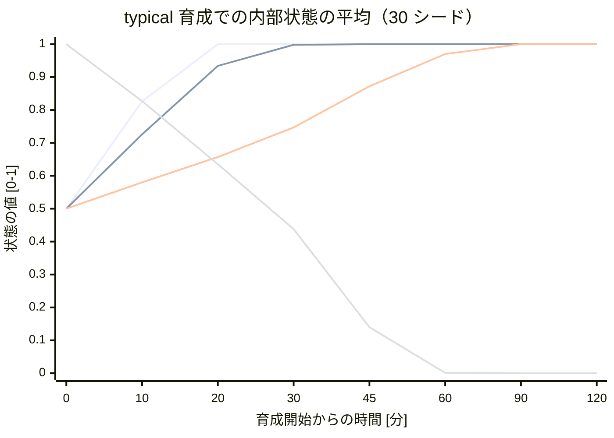

# 実験ノート：現在の研究パラメータで、内部状態は長期育成のどの時点で上限・下限に張り付くか（Phase 15）

| 項目 | 内容 |
|---|---|
| 日付 | 2026-11-14（土） |
| 実施者 | Claude Code（依頼：st19060nk） |
| 種別 | オフライン数値実験（Minecraft は起動しない） |
| 対象コード | `demo-mode` ブランチ。研究ロジックはコミット `29dde1b` と同一。測定コードはこのノートと同じコミット |
| パラメータ | `PARAMETER_SET_VERSION = 2`（**変更なし**）、条件 ADAPTIVE |
| シード | 30 個（20261114〜20261143）。シード i は出来事列と個体の乱数の両方を決める |
| 再現コマンド | `./gradlew saturation`（30 シード・120 分、約 30 秒） |
| 生の出力 | [`2026-11-14_state-saturation/`](2026-11-14_state-saturation/)：`saturation_report.md`（全表）、`saturation_summary.csv`（シードごとの指標）、`state_trajectory_mean.csv`（1 分刻みの平均・標準偏差）、`event_rates.csv`（仮定した頻度）。シードごとの 1 分刻みの軌跡 `state_trajectory.csv`（約 3 MB）は再現コマンドで作り直せるのでリポジトリには置いていない |

---

## 1. 目的

デモ用の 10 分育成で、Wolf A の trust・attachment と Wolf B の autonomy が上限 1.0 に達した
（[`2026-11-14_demo-effect-size.md`](2026-11-14_demo-effect-size.md) の考察 5）。
本実験は 30〜45 分 × 複数セッションの育成を予定しているので、**現在のパラメータのまま**、
内部状態が何分で上限（または下限）に張り付き、それ以降の経験差を表現できなくなるかを定量化する。

**このノートの結果だけを理由にパラメータを変えることはしない。** 変更は指導教員と相談したうえで別 Phase として行う。

## 2. 仮説

* **H1**：飼い主中心の育成では、ふつうの頻度でも 1 セッション目（30 分以内）に attachment が 0.99 に達する。
* **H2**：探索中心の育成では autonomy・curiosity が、危険の多い育成では fear・stress が同様に張り付く。
* **H3**：混合の育成でも、正の更新しか受けない状態は時間とともに必ず上限へ向かう。

H3 の根拠（コードの確認）：trust と attachment を**下げる出来事は 1 つもない**（`StateImpactMatrix`）。
また時間によるベースラインへの回帰は fear と stress（EMOTIONAL 区分）にしかなく、
trust・attachment・curiosity・autonomy は時間では減らない（`WolfInternalState.relaxEmotionalStatesTowardsBaseline`）。
したがって、これらは出来事が続く限り単調に増える。

## 3. 実験手順

### 3.1 育成パターンと出来事の頻度（仮定）

出来事の種類ごとに「1 分あたりの平均回数」を決め、10 秒ごとの枠で確率 rate / 6 で起こす
（撫でのクールダウン 10 秒と同じ刻み。rate ≤ 6）。**頻度は実機の発火条件から見て妥当と考えた仮定で、実測値ではない。**
強さは 2 段階：**typical**（ふつうに遊んだ場合の想定）と **intensive**（デモ撮影のように集中した場合。Demo D の育成と同程度）。

| パターン | typical の頻度 [回/分] | intensive |
|---|---|---|
| A 飼い主中心 | 撫で 2.0、餌 0.3、救援 0.1、そばで寝る 0.02 | 撫で 6.0、餌 1.0、救援 0.33、寝る 0.05 |
| B 探索中心 | 安全な単独探索 2.0、新バイオーム 0.1、敵の出現 0.1 | 探索 6.0、新バイオーム 0.33、敵 0.2 |
| C 危険が多い | 被弾 1.0、敵の出現 0.5、体力低下 0.2、瀕死 0.03、救援 0.2、防衛成功 0.2、飼い主の被弾 0.2、共闘 0.1 | すべて 2 倍 |
| D 混合 | 撫で 1.0、餌 0.15、救援 0.05、探索 0.8、新バイオーム 0.05、敵 0.2、被弾 0.2、防衛成功 0.05、共闘 0.05、寝る 0.02 | すべて 2 倍 |

### 3.2 時間の進め方

* 1 秒（20 ticks）ごとに、その秒の出来事を `WolfAiAgent.onEvent` で与え、`advanceTime(20)` で時間を進める
  （fear・stress のベースライン回帰と energy の増減は実機と同じ規則で起きる）。
* 2 秒ごとに `decide` を呼ぶ。決定は内部状態を直接は変えないが、現在の行動で energy の増減が変わるため。
  文脈はパターンごとの固定規則（A：飼い主 3 blocks、B：20 blocks、C：地下で 10 秒おきに敵 1 体、D：5〜15 blocks で時々敵）。
* 0〜120 分。状態は 1 分ごとに記録し、閾値の判定と張り付き時間は 1 秒刻みで行う。

### 3.3 指標

| 指標 | 定義 |
|---|---|
| 0.90 / 0.95 / 0.99 到達 [分] | 初めてその値以上になった時刻。到達したシードの**中央値**と、到達したシード数（n/30） |
| ≥0.99 の時間 [%] | 120 分のうち値が 0.99 以上だった時間の割合。30 シードの平均 |
| 0.01 以下到達 [分]、≤0.01 の時間 [%] | 下限側の同じ指標（fear・stress・energy が 0 に張り付く場合のため） |

energy は初期値が 1.0 なので、上限側の到達時刻は「初期値で該当」として扱う（飽和したわけではない）。

## 4. 結果

### 4.1 上限に張り付く状態（typical）

| パターン | 状態 | 0.90 到達 [分] | 0.95 到達 [分] | 0.99 到達 [分] | ≥0.99 の時間 [%] |
|---|---|---:|---:|---:|---:|
| A 飼い主中心 | attachment | 11.6 (30/30) | 13.5 (30/30) | **14.5 (30/30)** | **87.9** |
| A 飼い主中心 | trust | 18.2 (30/30) | 21.0 (30/30) | **23.5 (30/30)** | 80.5 |
| B 探索中心 | autonomy | 18.3 (30/30) | 20.3 (30/30) | **22.8 (30/30)** | 81.2 |
| B 探索中心 | curiosity | 26.4 (30/30) | 29.5 (30/30) | **31.9 (30/30)** | 73.1 |
| C 危険が多い | fear | 11.1 (30/30) | 12.3 (30/30) | 13.8 (30/30) | 23.5 |
| C 危険が多い | stress | 15.8 (30/30) | 17.8 (30/30) | 19.2 (30/30) | 25.4 |
| C 危険が多い | trust | 34.5 (30/30) | 37.3 (30/30) | 39.8 (30/30) | 68.2 |
| C 危険が多い | attachment | 75.1 (30/30) | 87.5 (29/30) | 90.6 (23/30) | 19.0 |
| D 混合 | attachment | 24.3 (30/30) | 27.0 (30/30) | **29.1 (30/30)** | 74.9 |
| D 混合 | trust | 34.9 (30/30) | 40.0 (30/30) | 43.2 (30/30) | 64.1 |
| D 混合 | autonomy | 47.7 (30/30) | 55.0 (30/30) | 60.0 (30/30) | 50.3 |
| D 混合 | curiosity | 68.9 (30/30) | 78.0 (30/30) | 83.0 (30/30) | 30.4 |

C の fear・stress は 0.99 に一瞬届くが、ベースラインへの回帰で 0.96〜0.97 付近にとどまるため、≥0.99 の時間は 25 % 前後。
**0.95 以上**で見ると、C の fear は 12.3 分以降ほぼずっと張り付いている（20 分以降の平均 0.962〜0.969）。

### 4.2 上限に張り付く状態（intensive）

| パターン | 状態 | 0.99 到達 [分] | ≥0.99 の時間 [%] |
|---|---|---:|---:|
| A 飼い主中心 | attachment | **5.0** | 95.9 |
| A 飼い主中心 | trust | 8.2 | 93.2 |
| B 探索中心 | autonomy | **7.8** | 93.5 |
| B 探索中心 | curiosity | 11.1 | 90.8 |
| C 危険が多い | fear | 5.5 | 44.9 |
| C 危険が多い | stress | 7.3 | 53.4 |
| C 危険が多い | trust | 19.8 | 83.5 |
| D 混合 | attachment | 15.7 | 87.1 |
| D 混合 | trust | 22.9 | 80.8 |
| D 混合 | autonomy | 28.0 | 76.1 |
| D 混合 | curiosity | 40.7 | 66.0 |

### 4.3 下限に張り付く状態

| パターン・強さ | 状態 | 0.01 以下到達 [分] | ≤0.01 の時間 [%] |
|---|---|---:|---:|
| A typical | stress | 10.2 (30/30) | 87.9 |
| A intensive | stress | 2.9 (30/30) | 97.6 |
| B typical | fear | 45.9 (30/30) | 20.9 |
| B intensive | fear | 8.7 (30/30) | 89.1 |
| B typical | **energy** | 51.8 (30/30) | **56.2** |
| B intensive | **energy** | 50.3 (30/30) | **57.5** |
| C typical | **energy** | 43.9 (30/30) | **59.3** |
| C intensive | **energy** | 33.1 (30/30) | **67.8** |

### 4.4 時間変化（typical、30 シードの平均）

| 時点 [分] | 0 | 10 | 20 | 30 | 45 | 60 | 90 | 120 |
|---|---:|---:|---:|---:|---:|---:|---:|---:|
| A attachment | 0.500 | 0.826 | 1.000 | 1.000 | 1.000 | 1.000 | 1.000 | 1.000 |
| A trust | 0.500 | 0.702 | 0.923 | 0.998 | 1.000 | 1.000 | 1.000 | 1.000 |
| B autonomy | 0.500 | 0.726 | 0.934 | 0.998 | 1.000 | 1.000 | 1.000 | 1.000 |
| B curiosity | 0.500 | 0.658 | 0.807 | 0.948 | 1.000 | 1.000 | 1.000 | 1.000 |
| C fear | 0.300 | 0.812 | 0.962 | 0.964 | 0.965 | 0.969 | 0.968 | 0.966 |
| D attachment | 0.500 | 0.661 | 0.829 | 0.967 | 1.000 | 1.000 | 1.000 | 1.000 |
| D autonomy | 0.500 | 0.580 | 0.657 | 0.747 | 0.872 | 0.970 | 1.000 | 1.000 |
| B energy | 1.000 | 0.827 | 0.635 | 0.438 | 0.140 | 0.001 | 0.000 | 0.000 |

（標準偏差は生の出力の `saturation_report.md` を参照。最大でも 0.15 程度）

図 1：上から順に立ち上がる線が A の attachment（約 15 分で 1.0）、B の autonomy（約 23 分）、
D の autonomy（約 60 分）。右下がりの線は B の energy（約 50 分で 0）。

## 5. 考察

### Q1：10〜120 分の育成で、内部状態はどの程度早く飽和するか

1. **H1 は支持された。** 飼い主中心の育成では、ふつうの頻度（撫で 2 回/分）でも attachment が中央値 **14.5 分**で 0.99 に達し、
   120 分のうち **88 %** の時間を上限で過ごした。trust も 23.5 分。デモ程度の集中した交流では 5〜8 分。
2. **H2 も支持された。** 探索中心では autonomy が 22.8 分、curiosity が 31.9 分。危険の多い育成では fear・stress が
   12〜19 分で 0.95 以上に張り付いた。
3. **H3 も支持された。** 混合の育成でも、trust・attachment・curiosity・autonomy の 4 つが**すべて** 1.0 に向かい、
   90 分の時点では 4 つとも 0.99 以上だった。混合の個体は最終的に「最大限に懐いていて、最大限に自律的で好奇心が強い」状態になり、
   内部状態の上では飼い主中心の個体とも探索中心の個体とも区別がつかなくなる方向へ進む。
4. 原因は構造的である：trust と attachment を下げる出来事がなく、関係性・動機づけの状態に時間減衰もないため、
   これらは**正の経験の累積カウンタ**として振る舞い、上限で打ち切られる。

### 本実験（30〜45 分 × 複数セッション）への影響（評価のみ。パラメータは変えていない）

* **1 セッション目で天井に達する。** typical の飼い主中心の育成では、attachment は 1 セッション目の途中（約 15 分）で、
  trust も 1 セッション目の終わりまで（約 24 分）に上限に達する。2 セッション目以降は、飼い主中心の経験をどれだけ重ねても
  内部状態は変わらない。**セッション間の変化を内部状態で測る分析（H2 の個体内変化）は、2 セッション目以降ほぼ平坦になる。**
* **個体間の差は「どの状態が張り付いたか」でしか残らない。** A 型と B 型は別々の状態が張り付くので区別できるが、
  同じ傾向の 2 個体の「経験の量の差」（例：撫で 200 回 vs 400 回）は、内部状態では表せない。
* **混合の経験が最も問題になる。** 自然なプレイに近い混合経験では、60〜90 分で複数の状態が同時に上限へ達し、
  個体差が縮む方向に働く。
* 天井に達した後の個体差は、エピソード記憶（ただし Top-5 と時間減衰で頭打ち）と選好（学習率が小さく 0.25 程度）が担うことになる。
  これらがどこまで補えるかは P1（アブレーションと個体性評価）で確かめる。

### 予想していなかった発見：energy の下限張り付き

* 探索中心・危険の多い育成では、energy が 45〜50 分で 0 に達し、以後 **56〜68 % の時間を 0 で過ごした**。
* 重み（`BehaviorWeights`）から計算すると、energy が 0（z = −1）のとき energy の項は EXPLORE_NEARBY で 0.4 × (−1) = −0.4、
  REST_NEAR_PLAYER で −1.0 × (−1) = +1.0 になり、休息が有利になる。しかし curiosity と autonomy が 1.0（z = +1）の個体では、
  EXPLORE_NEARBY に curiosity +1.0・autonomy +0.8 が加わるため、energy が 0 でも EXPLORE_NEARBY のスコアが上回り続ける。
  そのため休息が選ばれず、energy が回復しない。
* これは「疲れていても探索をやめない」挙動として実機でも起こりうる。ただし文脈の作り方（B では飼い主 20 blocks で REST は選択可能）
  に依存する可能性があるので、実機のログで確認が必要。

## 6. 限界

* **出来事の頻度は仮定**であり、実機のプレイの記録から推定したものではない。とくに typical の頻度は根拠が弱い。
  ただし頻度の仮定への感度は限られる：撫での頻度が A typical の半分（1 回/分）の D 混合 typical でも、
  attachment は中央値 29.1 分で 0.99 に達した（表 4.1）。減らす仕組みがない以上、頻度が下がっても到達が遅れるだけで、
  いずれ上限に張り付く点は変わらない。
* 決定時の文脈は固定の規則で作った。energy の結果はこの規則に依存する。
* 1 つの条件（ADAPTIVE）のみ。STATE_ONLY でも内部状態の更新規則は同じなので、天井の時刻は同じになるはずだが未測定。
* 「0.99 以上」は張り付きの定義の 1 つにすぎない。0.95 以上で見ると張り付き時間はさらに長い（生の CSV から計算可能）。

## 7. 次に行うべきこと

1. **（指導教員と相談）天井効果への対処を別 Phase として検討する。** 候補（いずれも未実施・パラメータ変更を伴う）：
   関係性・動機づけ状態の緩やかな時間減衰、負の出来事（長期分離など）による trust / attachment の低下、
   上限付近で増分を小さくする更新則（例：Δ × (1 − x)）。変更する場合は `PARAMETER_SET_VERSION` を上げ、パイロットを取り直す。
2. 実機のパイロットで、1 分あたりの出来事の実際の頻度を `events.jsonl` から数え、本ノートの typical の仮定を置き換えて再計算する。
3. P1：アブレーション（STATE_ONLY / STATE_MEMORY / STATE_PREFERENCE / FULL）と個体性評価で、
   内部状態が張り付いた後も記憶と選好が個体差を保てるかを測る。
4. energy の下限張り付きを実機ログで確認する（探索中心の個体で REST_NEAR_PLAYER の割合と energy の推移）。
